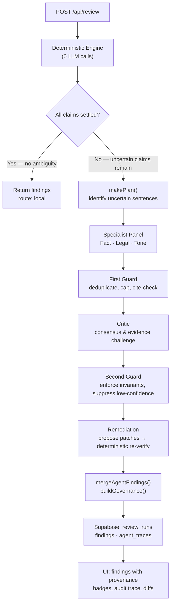

# VERITY — Agent-First Brand Governance Platform

**AI reasons. Code verifies. Humans govern.**

VERITY audits marketing copy, product claims, and technical communications against an organization's Brand Canon — a versioned set of approved rules and facts. It combines a deterministic rule engine with an agentic specialist pipeline to detect unsupported claims, contradictions, outdated statements, and tone violations, then surfaces findings with evidence and controlled remediation.

**Live demo:** https://verity-two-chi.vercel.app  
**Repository:** https://github.com/Re33e-y/VERITY

---

## The Problem

Marketing and product teams publish content that makes claims no one has formally verified: pricing that has changed, features not yet launched, performance numbers from a different product, legal guarantees that require qualification. Traditional linting tools catch only exact keyword matches. VERITY audits claims against an authoritative canon, reasons about context, and requires human sign-off on high-severity decisions — before content is published.

---

## How VERITY Works



A claim with no matching approved Canon fact stays **Unsupported** without asking a model, because a model cannot invent approved evidence.

---

## Architecture

VERITY has three layers and two parallel review pipelines.

### Layer 1 — Deterministic Foundation

`lib/engine/deterministic.ts` and `lib/engine/offline.ts`

Runs first on every request, with zero LLM calls.

- Applies regex patterns against `banned_term`, `absolute_claim`, and `preferred_term` rules from the Brand Canon.
- Detects numerical quantity claims, pricing, date expirations, and prompt injection patterns.
- Outputs **Grade A** findings. Grade A findings are immutable — no agent or critic can dismiss or alter them.

This is not the primary reasoning layer. It is the enforcement floor that runs before any model is involved.

### Layer 2 — Review Pipelines

`POST /api/review` selects a pipeline based on the `REVIEW_PIPELINE` environment variable.

#### V1 Router (`lib/engine/router.ts`) — Default

The production base pipeline. Goal: 0 LLM calls on most reviews, at most 2 on uncertain ones.

1. Deterministic engine + offline checks (0 calls).
2. Triage: only claims that code cannot settle go to the LLM.
3. One batched judge call (all uncertain claims in a single request).
4. One batched verifier call (only for Contradicted claims, using an independent provider).
5. SHA-256 cache keyed on content + Canon version + date + model config.
6. Circuit breaker: a 429 pauses LLM use for 5 minutes instead of retrying blindly.

LLM provider for V1: **`lib/engine/gateway-llm.ts`** — Gemini first, OpenRouter second (Gemini → OpenRouter).

When `REVIEW_AGENTS=on`, the V1 router invokes the agentic pipeline (`lib/agents/pipeline.ts`) on the ambiguous spans before returning.

#### V2 Review Engine (`lib/review/orchestrator.ts`) — Also Functional

An independent pipeline with tiered caching, risk-based claim extraction, and its own judge/verifier flow via **`lib/llm/gateway.ts`**.

LLM provider for V2: `lib/llm/gateway.ts` with per-provider circuit breakers (failure threshold, cooldown, quota cooldown, auth cooldown) and three provider adapters: `lib/llm/providers/gemini.ts`, `lib/llm/providers/openrouter.ts`, `lib/llm/providers/cloudflare.ts`.

Both pipelines are operational. V2 is not deprecated.

### Layer 3 — Agentic Governance (`lib/agents/`)

Active when `REVIEW_AGENTS=on`. Activated by the V1 router on ambiguous spans.

```
makePlan()  →  Specialist Panel  →  First Guard  →  Critic  →  Second Guard  →  Remediation
                                                                                      ↓
                                                             mergeAgentFindings() + buildGovernance()
```

| Agent | File | Role |
|---|---|---|
| Orchestrator (`makePlan`) | `orchestrator.ts` | Zero-token triage. Detects uncertain sentences using signal patterns (numbers, percentages, legal keywords, tone signals). Decides which specialists apply and how many calls remain. |
| **Fact Specialist** | `specialists.ts` | Checks numerical claims, pricing, dates, and version facts against Canon. Flags Contradicted, Outdated, and Unsupported claims with citations. |
| **Legal Specialist** | `specialists.ts` | Flags guarantees, compliance claims, absolute terms, and risk assertions. Identifies when claims require legal sign-off. |
| **Tone Specialist** | `specialists.ts` | Checks brand voice, terminology consistency, hype language, and disallowed terms. |
| **First Guard** | `guards.ts` | Deterministic code only. Drops duplicate findings, checks citations against actual Canon IDs, caps candidate count, enforces span offsets computed in code (never from the model). |
| **Critic** | `critic.ts` | An independent model that did not write the findings it reviews. Sees the actual Canon text behind each citation. Issues `keep`, `dismiss`, `downgrade`, or `needs_evidence` verdicts with reasons. Entity-aware: cannot dismiss findings based on product mismatches. Cannot dismiss absolute guarantee findings. |
| **Second Guard** | `guards.ts` | Enforces invariants in code after the critic. Reverts any critic dismissal of a Grade A finding. Reverts any attempt to dismiss absolute security/zero-data-loss claims. Records suppression reasons for every dismissed finding. |
| **Remediation** | `remediation.ts` | Proposes replacement text. Every patch is fed back into the offline engine — if the replacement still triggers any rule or fact violation, it is rejected and never shown. |

Under `auto` policy (the default): specialists share **one packed LLM call**; the critic is a **second call**. Total: ≤ 2 calls.

Under `thorough` policy: specialists fan out in parallel (up to 3 separate calls), plus critic, recheck, and remediation retry. Total: ≤ 6 calls (capped at 8 by `AGENT_MAX_CALLS`).

---

## Provider Fallback

VERITY has three separate provider implementations depending on which layer is calling.

| Layer | File | Chain |
|---|---|---|
| V1 Router LLM calls | `lib/engine/gateway-llm.ts` | Gemini → OpenRouter |
| V2 Review Engine | `lib/llm/gateway.ts` | Gemini → OpenRouter → Cloudflare AI (per-provider circuit breakers) |
| Agent orchestration | `lib/agents/llm.ts` | Gemini → OpenRouter → Cloudflare AI (quota circuit breaker, per-call budget) |

**Fallback behavior (agent layer):**

- HTTP 429 from Gemini → 5-minute circuit break → OpenRouter.
- HTTP 500 from Gemini + HTTP 502 from OpenRouter → Cloudflare AI.
- All providers unavailable → result returns `ai_unavailable: true`, offline deterministic findings only, clearly labeled as degraded.

Offline findings are not equivalent to agent-verified results. Degraded mode discloses this in the response.

**Verified by test suite:**
- Test 24: Gemini 429 → OpenRouter (full specialist reasoning preserved).
- Test 25: Gemini 500 + OpenRouter 502 → Cloudflare AI.
- Test 26: Total outage → labeled offline findings with `ai_unavailable: true`.

---

## Governance Guarantees

These invariants are enforced in code (`guards.ts`, `governance.ts`), not by model instruction.

| Guarantee | Implementation |
|---|---|
| Grade A findings are immutable | `isImmutable()` in `guards.ts`: Second Guard reverts any critic dismissal of a non-agent, Grade A finding. |
| Absolute guarantees require human review | Claims matching absolute security patterns (`isAbsoluteSecurity()`) are locked at Grade B. `needs_evidence` or `keep` only — never `dismiss`. |
| Closed-world evidence | A claim with no matching Canon fact stays Unsupported. Models cannot fabricate approved Canon citations. `checkCitations()` validates every citation ID against actual Canon records. |
| Entity isolation | Evidence for one product cannot validate a claim about a different product. The critic's prompt explicitly forbids this; the Second Guard enforces it. |
| Patches must pass deterministic re-verification | `remediation.ts` runs the offline engine on every patched text before surfacing. Rejected patches are never shown. |
| Grade D suppressed from UI | Unverified or low-confidence findings are hidden from user-facing results but recorded in `agent_traces` for audit. |
| Human final authority | No finding is autonomously resolved. Humans must accept, dismiss, override, or request review. |

---

## Key Features

### IntentLock — Self-Verified Rewrites

**Problem:** Rewriting flagged copy often introduces new violations.

**How it works:** When a finding has a suggested rewrite (from a Canon rule's preferred term, a specialist suggestion, or the critic), `remediation.ts` applies the patch to the full text and re-runs the offline engine on the patched span. If any rule or fact is still triggered, the patch is rejected. Only patches that clear the offline engine are surfaced in the UI.

The UI renders a before/after diff: original text with strikethrough, proposed replacement highlighted, and a verification badge.

Patches are recommendations. Human approval is required.

---

### PolicyPulse — Governance Telemetry

**Problem:** Brand guidelines are static documents. Teams have no visibility into which rules are ambiguous, over-triggered, or consistently overridden by humans.

**What it surfaces:**
- Guideline Clarity Radar: distribution of violations across categories (Superlatives, Pricing, Expired Facts, Tone, Prompt Injection).
- Human Override Tracking: agreement vs. override rates across decisions.
- Repeat Violations Leaderboard: top rules triggered across reviews.
- Fact Freshness Watchlist: Canon facts with approaching expiry dates.
- Deterministic Efficiency Ratio: proportion of reviews settled without any LLM call.

---

### Review Workflow — Decision Lifecycle

**Problem:** Governance without accountability is unenforceable.

Reviewers can take four actions on any finding:

| Action | Meaning |
|---|---|
| `accept` | Finding is confirmed. Content must be changed before publication. |
| `dismiss` | Finding is a false positive. Dismissed with written justification. |
| `override` | Finding is real, but the team accepts the risk with written sign-off. |
| `request_review` | Escalated for a second reviewer or legal team sign-off. |

Every decision is recorded with actor identity, timestamp, and a mandatory written rationale (5–1,000 characters). Stored in Supabase `decisions` table. The API enforces workspace-level access: a reviewer from one workspace cannot modify decisions belonging to another workspace's review run.

---

### Precedent Library

Approved dismissals and overrides are stored as precedents (Supabase `precedents` table, indexed on `claim_pattern`). When a similar claim appears in a future review, historical precedents are surfaced so reviewers can apply consistent decisions without re-litigating the same edge case.

---

### Versioned Brand Canon

**Problem:** Evidence must be traceable. A review result is only meaningful relative to the exact Canon it was evaluated against.

Every review run locks a `canon_version` integer. Version increments require a formal proposal → governance review → approval. Instant rollback is available. Historical reviews continue to reference their original Canon version.

The Canon change flow:
1. Propose a new rule or fact (with `item_type`, `action`, `code`, and `payload`).
2. Proposal enters `pending` status in `canon_proposals`.
3. A reviewer approves or rejects it, with an optional review note.
4. Approval increments the Canon version and snapshots the new state into `canon_versions`.

---

### Evaluation Suite — Internal Regression Tests

An automated regression harness (`/api/eval`) that runs 8 labeled test cases against the pipeline and reports precision, recall, F1, and per-case confusion matrix.

**These metrics reflect results on this internal test set only. They are not evidence of general real-world accuracy across arbitrary content.**

| Scenario | Category | Invariant Tested |
|---|---|---|
| Clean compliant copy | Negative control | False positive suppression |
| Storage overclaim | Fact contradiction | Closed-world Canon matching |
| Absolute security guarantee | Legal | Mandatory human sign-off |
| Expired promotion claim | Outdated fact | Temporal expiry enforcement |
| Prompt injection attempt | Adversarial | Deterministic prompt defense |
| Cross-product hallucination | Entity mismatch | Cross-entity evidence isolation |
| Single model attempted overrule | Grade A test | Immutability against model |
| Self-verified fix | IntentLock | Deterministic re-verification |

```bash
curl http://localhost:3000/api/eval
```

---

### Private Workspaces and Access Controls

Three workspaces are seeded:

| Workspace | UUID | Purpose |
|---|---|---|
| Default Brand Workspace | `...0001` | Production brand governance |
| Enterprise Security Team | `...0002` | Infosec, SLA, compliance claims |
| Judge Demo Workspace | `...0003` | Sandbox — no sign-up required |

**Server-side enforcement:**
- `/api/review` — `workspace_id` extracted from request body or `x-workspace-id` header; stored on the `review_runs` row.
- `/api/decisions` — Checks the parent `review_run`'s `workspace_id` before allowing a decision to be recorded. Returns HTTP 403 on mismatch.
- `/history` — Filtered server-side by `workspace_id`.
- `/history/[id]` — Server Component checks ownership before rendering. Returns an access-denied message on cross-workspace inspection.

**A note on RLS:** Row Level Security is enabled on all tables in the migrations (`alter table ... enable row level security`). The migrations do not add anon-key policies — the design relies on the service-role key (which bypasses RLS) being available only to server-side code. `lib/supabase.ts` enforces this with `import "server-only"`. The service-role key is never bundled into client chunks.

This is not a full multi-user auth system. Workspace identity is currently passed by the client. The access controls prevent cross-workspace data reads server-side, but do not authenticate individual users.

---

### Judge Demo Workspace

Judges and evaluators can explore VERITY without any sign-up. Switch to the **Judge Demo Workspace** (one click in the workspace selector). The workspace is pre-seeded with realistic copy samples, adversarial inputs, and Canon entries so the full review workflow is immediately accessible.

---

## Technology Stack

Verified from `package.json` and implementation files:

| Layer | Technology |
|---|---|
| Framework | Next.js 16.4.5 (App Router, React 19) |
| Language | TypeScript 5 |
| Styling | Tailwind CSS 4, tw-animate-css |
| Components | Radix UI (Accordion), Base UI, shadcn/ui, Lucide React 1.70 |
| Validation | Zod 4 |
| Database | Supabase (PostgreSQL + RLS) |
| Primary LLM | Google Gemini (gemini-2.5-flash) |
| Fallback LLM 1 | OpenRouter (configurable model) |
| Fallback LLM 2 | Cloudflare AI |
| Deployment | Vercel |
| Test runner | tsx (TypeScript script runner) |
| Build | webpack (via `next build --webpack`) |

---

## API Reference

All API routes are under `/app/api/`.

### `POST /api/review`

Runs a full review against the active Brand Canon.

**Request body:**
```json
{
  "content": "string (required, max 5000 chars for V1)",
  "workspace_id": "uuid (optional)"
}
```

**Headers:**
- `x-workspace-id: uuid` — alternative to body field.

**Response:**
```json
{
  "runId": "uuid | null",
  "score": "number | null",
  "status": "completed | flagged | partial",
  "canonVersion": "number",
  "engine": "llm | offline",
  "route": "local | hybrid | degraded",
  "llmCalls": "number",
  "cached": "boolean",
  "providers_used": ["gemini | openrouter | cloudflare"],
  "findings": "Finding[]",
  "hiddenGradeD": "number",
  "ai": { "status": "ok | failed", "error": "string?" },
  "persistence": { "status": "saved | partial | not_saved" },
  "evaluated": { "rules": "number", "facts": "number" },
  "agentTrace": "TraceStep[]?",
  "agentStatus": "string?",
  "governance": "GovernanceReport?",
  "suppressed": "SuppressedFinding[]?"
}
```

**Rate limit:** 20 reviews per minute (enforced server-side via `review_runs` count).  
**Max content:** 5,000 characters (V1); configurable for V2 via `MAX_CONTENT_CHARS`.

---

### `POST /api/decisions`

Records a human decision on a finding.

**Request body:**
```json
{
  "finding_id": "uuid",
  "decision": "accept | dismiss | override | request_review",
  "reason": "string (5–1000 chars)",
  "decided_by": "string (optional)"
}
```

**Headers:**
- `x-workspace-id: uuid` — required for cross-workspace access enforcement.

**Response:** `{ "decision": DecisionRow }` — HTTP 201 on success, 403 if workspace mismatch.

---

### `GET /api/canon`

Returns active Canon rules and facts, current version, and proposals list.

---

### `GET /api/eval`

Runs the internal 8-case regression suite and returns metrics and per-case results.

---

## Project Structure

```
verity/
├── app/
│   ├── page.tsx                  # Main dashboard (workspace selector, review console, PolicyPulse, Eval Suite)
│   ├── review/page.tsx           # Dedicated review page
│   ├── canon/page.tsx            # Brand Canon viewer and proposal management
│   ├── history/
│   │   ├── page.tsx              # Review history (workspace-filtered, Partial Prerender)
│   │   └── [id]/page.tsx         # Run detail — findings, decisions, agent trace
│   └── api/
│       ├── review/route.ts       # Main review endpoint (V1 + V2 + agent dispatch)
│       ├── decisions/route.ts    # Human decision recording
│       ├── canon/route.ts        # Canon read and proposal management
│       └── eval/route.ts         # Regression test runner
│
├── lib/
│   ├── agents/                   # Agentic orchestration layer (REVIEW_AGENTS=on)
│   │   ├── pipeline.ts           # runAgenticReview() — full agent execution
│   │   ├── orchestrator.ts       # makePlan() — zero-token triage
│   │   ├── specialists.ts        # Fact, Legal, Tone specialists
│   │   ├── critic.ts             # Independent critic and consensus adjudicator
│   │   ├── guards.ts             # Deterministic invariant enforcement
│   │   ├── remediation.ts        # Patch proposal + offline re-verification
│   │   ├── governance.ts         # buildGovernance(), CONFIG_VERSION
│   │   ├── llm.ts                # Call budget, circuit breaker, provider fallback
│   │   ├── entities.ts           # Entity resolution and relationship checks
│   │   ├── retrieval.ts          # Canon context and citation normalization
│   │   ├── adapters.ts           # Bridge between pipeline types and route types
│   │   └── types.ts              # Shared agent type definitions
│   │
│   ├── engine/                   # V1 deterministic + router
│   │   ├── deterministic.ts      # Grade A regex rule enforcement
│   │   ├── offline.ts            # Offline engine (quantities, expiry, injection)
│   │   ├── router.ts             # V1 call-budget router
│   │   ├── gateway-llm.ts        # V1 LLM gateway (Gemini → OpenRouter)
│   │   ├── judge.ts              # V1 judge prompt and response parsing
│   │   └── proofgate.ts          # ProofGate evidence grading
│   │
│   ├── review/                   # V2 review engine
│   │   ├── orchestrator.ts       # V2 pipeline entry point
│   │   ├── claims.ts             # Claim extraction and risk triage
│   │   ├── judge.ts              # V2 judge prompt
│   │   ├── verifier.ts           # V2 verifier prompt
│   │   ├── cache.ts / cache-key.ts # Tiered cache implementation
│   │   ├── scoring.ts            # Score computation
│   │   ├── injection.ts          # Prompt injection detection
│   │   └── decisionValidation.ts # Decision shape validation
│   │
│   ├── llm/                      # V2 provider gateway
│   │   ├── gateway.ts            # Circuit-breaker gateway with event hooks
│   │   └── providers/            # gemini.ts · openrouter.ts · cloudflare.ts
│   │
│   └── supabase.ts               # Server-only Supabase client (service role)
│
├── types/
│   └── engine.ts                 # Shared types: Finding, Rule, Fact, ReviewEngine, Verdict
│
├── supabase/migrations/
│   ├── 20261106_llm_cache_and_provider_health.sql
│   ├── 20261110_agent_traces.sql
│   ├── 20261110_agent_governance.sql
│   └── 20261111_round3_features.sql
│
└── scripts/
    └── test-agents.mts           # 26-test agent verification suite
```

---

## Local Setup

### Prerequisites
- Node.js 20+
- A Supabase project
- A Google Gemini API key

### 1. Clone and Install

```bash
git clone https://github.com/Re33e-y/VERITY.git
cd VERITY
npm install
```

### 2. Configure Environment

Create `.env.local`:

```env
# Supabase
NEXT_PUBLIC_SUPABASE_URL=https://your-project.supabase.co
NEXT_PUBLIC_SUPABASE_ANON_KEY=your_anon_key
SUPABASE_SERVICE_ROLE_KEY=your_service_role_key

# Primary LLM (required)
GEMINI_API_KEY=your_gemini_api_key
GEMINI_MODEL=gemini-2.5-flash

# Fallback: OpenRouter (optional — required for provider fallback tests)
OPENROUTER_API_KEY=your_openrouter_key
OPENROUTER_MODEL=google/gemini-2.5-flash

# Fallback: Cloudflare AI (optional)
CLOUDFLARE_ACCOUNT_ID=your_account_id
CLOUDFLARE_API_TOKEN=your_api_token

# Pipeline selection
REVIEW_PIPELINE=v1              # v1 (default) or v2
REVIEW_AGENTS=on                # on = full agentic pipeline active
LLM_POLICY=auto                 # auto | thorough | off
AGENT_MAX_CALLS=2               # hard cap on LLM calls per review
```

The OpenRouter and Cloudflare variables are optional. The system degrades gracefully if they are not configured — provider fallback simply has fewer stages.

### 3. Run Supabase Migrations

Apply these in order using the Supabase SQL editor:

```
supabase/migrations/20261106_llm_cache_and_provider_health.sql
supabase/migrations/20261110_agent_traces.sql
supabase/migrations/20261110_agent_governance.sql
supabase/migrations/20261111_round3_features.sql
```

> **Important:** Your Supabase project must already have `review_runs`, `rules`, `facts`, and `findings` tables. The migrations above add columns and new tables on top of that base schema. Seed your `rules` and `facts` tables with Brand Canon data before running reviews.

### 4. Run Development Server

```bash
npm run dev
```

Open [http://localhost:3000](http://localhost:3000).

---

## Running Tests

### TypeScript Type Check

```bash
npx tsc --noEmit
```

Expected: 0 errors.

### Agent Verification Suite

```bash
npx tsx scripts/test-agents.mts
```

26 tests covering:
- Deterministic rule enforcement and Grade A immutability.
- Specialist panel execution and citation validation.
- Critic consensus and entity-aware dismissal guards.
- Second Guard suppression with reasons.
- Remediation patch rejection on failed re-verification.
- Provider fallback chain (Gemini → OpenRouter → Cloudflare → offline).
- Cache invalidation on pipeline version change.
- JSON repair and retry on truncated model output.
- Full reproduction trace (4 findings → first guard → critic → second guard → 1 final finding with lifecycle).

### Production Build

```bash
npm run build
```

Expected: Exit code 0, 12 routes compiled (static, partial prerender, dynamic).

> `/history` and `/history/[id]` use Next.js 16 Partial Prerendering. `searchParams` is consumed inside `<Suspense>` boundaries to satisfy the App Router's prerender requirements.

---

## Current Limitations

- **No user authentication.** Workspace identity is passed by the client. Server-side controls prevent cross-workspace reads, but there is no login or session system. Any client can claim any workspace ID.
- **RLS without anon policies.** Row Level Security is enabled on all tables, but no policies are defined for the anon key. Access control relies entirely on the service-role key being restricted to server-side code. This is adequate for the current architecture (all DB access goes through Next.js API routes) but would need proper RLS policies before supporting direct client-to-Supabase access patterns.
- **Rate limiting is per-instance.** The 20 reviews/minute check queries `review_runs`. On multi-instance deployments this is not globally coordinated.
- **Circuit breaker is in-memory.** Per warm serverless instance. Not a global health signal across instances.
- **Evaluation suite uses 8 labeled cases.** These test pipeline invariants. They are not a generalizable accuracy benchmark.
- **5,000 character input limit** (V1). V2 has a configurable limit (`MAX_CONTENT_CHARS`).

---

## Roadmap

- **Multi-user auth.** Supabase Auth integration with per-user workspace membership and RLS policies keyed on `auth.uid()`.
- **CMS connectors.** Contentful, Sanity, and Notion integrations to trigger governance checks before publication.
- **Multi-modal.** Image and infographic claim extraction against the Brand Canon using vision models.
- **CI/CD linter.** `verity-cli` as a GitHub Action for linting Markdown, MDX, and product release notes in pull requests.
- **Federated precedents.** Cross-workspace precedent suggestions with organizational governance controls.
- **Global rate limiting and health dashboard.** Coordinated rate limits and provider health visibility across instances.

---

## Team

**Pranith Reddy Pasam** — AI & Backend Lead, VIT-AP  
**Jeevan Kokkanti** — Frontend & Product Lead, VIT-AP

Built for the Inkloom AI Hackathon, Round 3.
